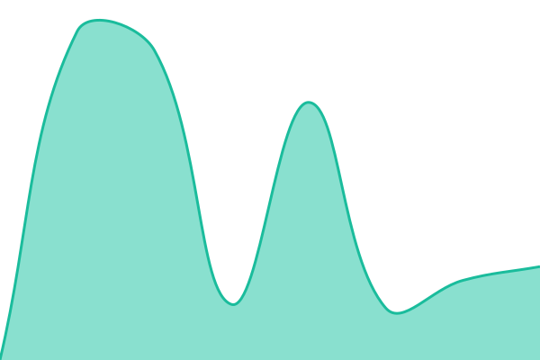

# [📈 Live Status](https://0zunu.github.io/Status-Page-Advanced): <!--live status--> **🟩 All systems operational**

This repository contains the open-source uptime monitor and status page for [Azriel Fidzlie](https://0zunu.github.io/Status-Page-Advanced), powered by [Upptime](https://github.com/upptime/upptime).

With [Upptime](https://upptime.js.org), you can get your own unlimited and free uptime monitor and status page, powered entirely by a GitHub repository. We use [Issues](https://github.com/0zunu/Status-Page-Advanced/issues) as incident reports, [Actions](https://github.com/0zunu/Status-Page-Advanced/actions) as uptime monitors, and [Pages](https://0zunu.github.io/Status-Page-Advanced) for the status page.

<!--start: status pages-->
<!-- This summary is generated by Upptime (https://github.com/upptime/upptime) -->
<!-- Do not edit this manually, your changes will be overwritten -->
<!-- prettier-ignore -->
| URL | Status | History | Response Time | Uptime |
| --- | ------ | ------- | ------------- | ------ |
|  [</azriel.>](https://www.azriel.id) | 🟩 Up | [azriel.yml](https://github.com/0zunu/Status-Page-Advanced/commits/HEAD/history/azriel.yml) | 

 552ms
     
 | 

<a href="https://status.azriel.id/history/azriel">100.00%</a>
    

|  [SMKN 34 Jakarta E-Learning](https://elearningsmkn34jkt.sch.id) | 🟩 Up | [smkn-34-jakarta-e-learning.yml](https://github.com/0zunu/Status-Page-Advanced/commits/HEAD/history/smkn-34-jakarta-e-learning.yml) | 

 944ms
     
 | 

<a href="https://status.azriel.id/history/smkn-34-jakarta-e-learning">100.00%</a>
    

|  [KIAT](https://antamkiat.com) | 🟩 Up | [kiat.yml](https://github.com/0zunu/Status-Page-Advanced/commits/HEAD/history/kiat.yml) | 

 649ms
     
 | 

<a href="https://status.azriel.id/history/kiat">100.00%</a>
    

<!--end: status pages-->

[**Visit our status website →**](https://0zunu.github.io/Status-Page-Advanced)

## 📄 License

- Powered by: [Upptime](https://github.com/upptime/upptime)
- Code: [MIT](./LICENSE) © [0zunu](https://0zunu.github.io/Status-Page-Advanced)
- Data in the `./history` directory: [Open Database License](https://opendatacommons.org/licenses/odbl/1-0/)
